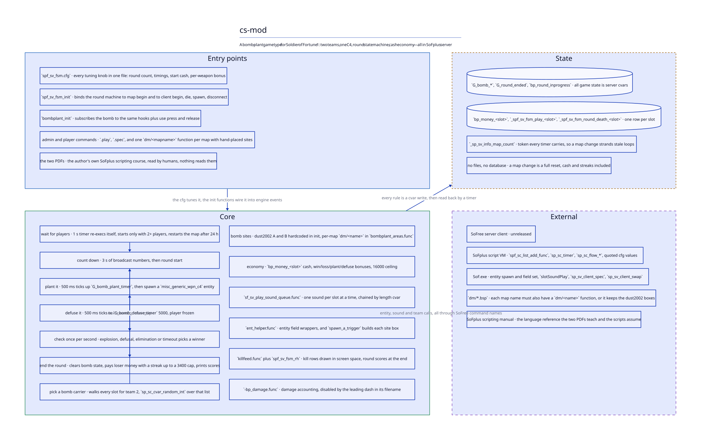

# cs-mod

A Counter-Strike style bomb-plant/defuse gametype for Soldier of Fortune 1 — two teams, one C4, rounds, and a cash economy — written almost entirely in SoFplus server script, and requiring an SoFree server client that has not been released.

Read it left to right:

- **Two scripts, one event bus, zero direct calls.** `spf_sv_fsm.func` owns the round clock and `bombplant.func` owns the bomb, but neither calls the other: both append themselves to the same `_sp_sv_on_*` hook lists, and everything they need to tell each other is written into a cvar that the other one polls. That is why the whole state zone is cvars — the modules are decoupled *by* the engine, not by design.
- **Every timer carries a map generation number.** Each scheduled call passes `_sp_sv_info_map_count` and the first thing the function does is bail if it no longer matches. Without it a map change would leave a dozen 1-second loops alive, all still writing to a fresh round; it is the only thing making the timers safe to abandon.
- **Rounds end by polling once a second.** Explosion, defusal, elimination and timeout are checked in one `sp_sc_timer` loop, so two events in the same second race and whichever `if` comes first wins — the source has a comment admitting the timing and a half-finished fix that compares `G_bp_ct_death_time`. Nothing is event-driven here, so "bomb exploded as the last defender died" is decided by declaration order.
- **The economy is a number nobody can spend.** Buy cash is awarded on win, loss, plant, defuse and kill, clamped to `G_bp_max_cash` 16000 and carried per slot across rounds, but the buy menu that would consume it does not exist yet — the README lists "a gimme method to spawn items" as one of the missing pieces. `spf_sv_fsm.cfg` also repeats `G_bonus_mod_33` and `G_bonus_mod_37` and skips 32, so those two weapon bonuses simply overwrite each other.
- **Bomb sites are hand-typed boxes.** dust2002's A and B coordinates live inside `bombplant_init`; other maps override them with a `dm/<mapname>` function in `bombplant_areas.func`. A map with no such function silently inherits dust2002's boxes, `aztec2001` and `dust2001` copy dust2002's B box verbatim, and `velruf_x` sets `size~` instead of `~size`, so its second site reuses the first site's size.

Diagram source: [`docs/system.d2`](docs/system.d2) · renderer: [`scripts/render-diagram.sh`](scripts/render-diagram.sh).
